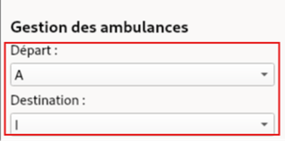
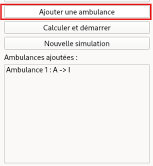
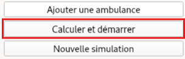
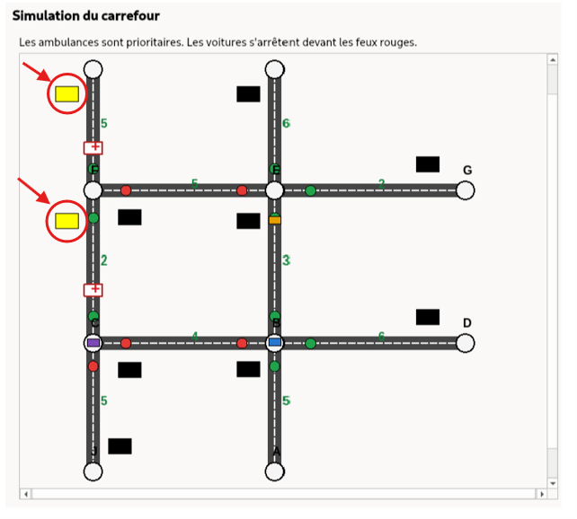
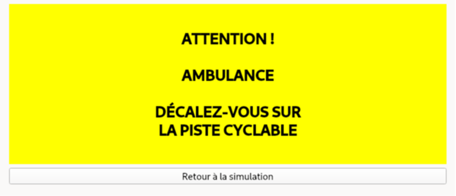

# SAE302 – Développer une application communicante

## 1. Présentation du projet

Ce projet a été réalisé dans le cadre de la SAE 3.02.

Il consiste à simuler la gestion de carrefours connectés afin de faciliter le déplacement des véhicules d'urgence. L'application utilise une interface graphique Python, une communication client-serveur par sockets TCP et une base de données MariaDB permettant d'enregistrer les événements.

## 2. Membres du groupe

- **Nom du groupe :** BC Galactique
- **Étudiante 1 :** DAYA Chloé
- **Étudiante 2 :** LAFAGE Bernadette

## 3. Installation et déploiement

### 3.1. Prérequis

Le projet est déployé sur une machine virtuelle Debian.

Les outils nécessaires sont :
- Git
- Python 3
- pip
- venv
- PyQt6
- MariaDB

### 3.2. Installation des paquets

Ouvrir un terminal et passer en administrateur :

```bash
su 
```

Mettre à jour la liste des paquets :

```bash
apt update
```

Installer les outils nécessaires :

```bash
apt install git python3 python3-pip python3-venv
apt install python3-pyqt6
apt install mariadb-server
```

### 3.3. Récupération du projet

Revenir sur le compte utilisateur normal, puis cloner le dépôt GitHub :

```bash
git clone https://github.com/Bernadette-23/SAE302.git
```

Accéder au dossier du projet :

```bash
cd SAE302
```

### 3.4. Création de l'environnement virtuel

Créer l'environnement virtuel Python :

```bash
python3 -m venv venv
```

L'activer :

```bash
source venv/bin/activate
```

Mettre pip à jour :

```bash
python -m pip install --upgrade pip
```

Installer les dépendances du projet :

```bash
pip install -r requirements.txt
```

Vérifier les paquets installés :

```bash
pip list
```

### 3.5. Initialisation de la base de données

Vérifier que le service MariaDB fonctionne :

```bash
systemctl status mariadb
```

Passer en **administrateur** et importer le fichier SQL fourni avec le projet :

```bash
mariadb < database/sae302.sql
```

**Configuration :** vérifier les paramètres de connexion à la base de données dans `commun/base_donnees.py` (adresse IP, port, utilisateur, mot de passe et nom de la base).

## 4. Utilisation de l'application

L'application nécessite deux terminaux ouverts simultanément.

### 4.1. Démarrage du serveur

Dans un premier terminal, se placer à la racine du projet et activer l'environnement virtuel :

```bash
cd SAE302
source venv/bin/activate
```

Lancer le serveur :

```bash
python -m serveur.serveur
```

Le serveur est alors en attente de demandes des clients.

### 4.2. Démarrage de l'interface graphique

Dans un deuxième terminal, se placer à la racine du projet et activer l'environnement virtuel :

```bash
cd SAE302
source venv/bin/activate
```

Lancer l'application :

```bash
python main.py
```

L'interface graphique permet ensuite d'utiliser la simulation et d'envoyer des demandes de trajet pour les véhicules d'urgence.

### 4.3. Exemple d'utilisation de l'interface graphique

Une fois l'interface graphique ouverte et le serveur démarré, il est possible de simuler le trajet d'une ambulance en suivant les étapes ci-dessous.

#### Étape 1 : choisir le départ et la destination de l'ambulance

Dans la zone **Gestion des ambulances**, sélectionner le point de départ et le point d'arrivée à l'aide des deux menus déroulants.



#### Étape 2 : ajouter l'ambulance

Cliquer sur le bouton **« Ajouter une ambulance »**. L'ambulance sélectionnée est alors ajoutée à la liste des ambulances en attente de simulation.



#### Étape 3 : calculer le trajet et démarrer la simulation

Cliquer sur le bouton **« Calculer et démarrer »**. La demande est transmise au serveur, qui calcule le trajet. La simulation peut ensuite démarrer avec le trajet obtenu.




### 4.4 Utilisation des panneaux d'avertissement

Lors de la simulation, des panneaux d'avertissement sont placés à proximité des routes afin de prévenir les autres usagers de l'arrivée d'une ambulance.

**4.4.1. Repérer un panneau jaune**

Lorsqu'une ambulance approche, le panneau concerné devient **jaune** pour signaler une situation d'urgence.

Pour consulter le message d'avertissement, cliquez directement sur le panneau jaune dans la simulation.



**4.4.2. Consulter le message d'urgence**

Une fenêtre affiche alors le message suivant :



Ce message informe les usagers qu'un véhicule d'urgence arrive et qu'ils doivent lui faciliter le passage.


**4.4.3. Revenir à la simulation**

Après avoir consulté le message, cliquez sur le bouton **« Retour à la simulation »** pour revenir à l'affichage du réseau routier.


### 5. Arrêt de l'application

Fermer l'interface graphique.

Pour arrêter le serveur, revenir dans le terminal où il est lancé et utiliser `Ctrl + C`.

## 6. Arborescence du projet

```text
SAE302/
├── client/
│   ├── __init__.py
│   └── client.py
├── commun/
│   ├── __init__.py
│   ├── base_donnees.py
│   ├── export_csv.py
│   └── gestion_trajet.py
├── database/
│   └── sae302.sql
├── exports/
│   └── evenements.csv
├── serveur/
│   ├── __init__.py
│   └── serveur.py
├── main.py
├── requirements.txt
└── README.md
```
